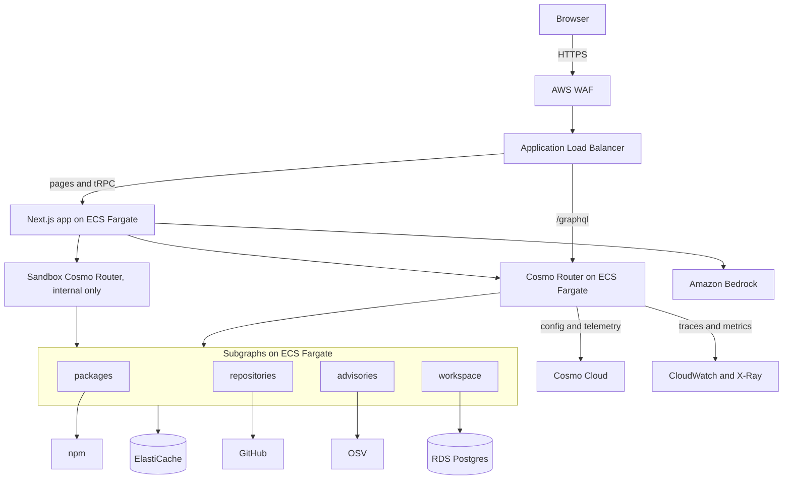

# Traverse

[](https://github.com/ayenisholah/traverse/actions/workflows/ci.yml)
[](https://github.com/ayenisholah/traverse/actions/workflows/codeql.yml)
[](docs/TEST_STRATEGY.md#coverage-policy)
[](https://github.com/ayenisholah/traverse/releases/latest)
[](LICENSE)
[](.nvmrc)

Explore a federated GraphQL graph from the frontend, built on [WunderGraph Cosmo](https://cosmo-docs.wundergraph.com/overview).

Traverse answers two questions for frontend developers: **which subgraphs does my query touch, and what breaks if this schema changes?**

> [!NOTE]
> **Status: early development.** Today the repository holds the specification, the quality gates, a searchable graph map and an impact check on the Cosmo demo, a CLI on npm and a GitHub Action that check a repository, the design tokens, and the core that composes a graph, finds who owns a field and works out what a schema change breaks. It also holds three subgraphs that serve live npm, GitHub and OSV data, with caching and retries, joined behind the pinned Cosmo Router with a hardened, persisted-operations-only config. The graph runs locally in Docker, and isn't hosted yet. The rest of this page is planned and not built yet.

**[Try the demo](https://ayenisholah.github.io/traverse/)**, on the Cosmo demo schemas, with no sign-in.

## What you'll be able to do

| Job                                      | How Traverse helps                                                                                                                       |
| ---------------------------------------- | ---------------------------------------------------------------------------------------------------------------------------------------- |
| Catch breaks in code that hasn't shipped | A CLI and GitHub Action read your repository's operations, compose your proposed schema, and comment on the pull request with what broke |
| Find who owns a field                    | Trace any field to its subgraph and owner                                                                                                |
| See a query's cost before shipping       | See the real query plan as a route: which subgraphs it hits, and in what order                                                           |
| Learn an unfamiliar graph                | Search a map of subgraphs, entities and owners                                                                                           |
| Vet a dependency                         | Paste a `package.json` to see licences, advisories and maintenance from live data                                                        |

It works on any Federation SDL, and the core needs no account and no AI.

## Why it's built on Cosmo

| Cosmo part                                                                           | What Traverse uses it for                                  |
| ------------------------------------------------------------------------------------ | ---------------------------------------------------------- |
| [`@wundergraph/composition`](https://www.npmjs.com/package/@wundergraph/composition) | Real federation composition, in the CLI and in the browser |
| [Cosmo Router](https://cosmo-docs.wundergraph.com/router/intro)                      | Serves the graph, and provides real query plans            |
| Cosmo Cloud and Studio                                                               | Schema registry, composition checks and analytics          |
| `wgc`                                                                                | Schema checks and publishing                               |

## How it fits with other tools

Traverse complements these tools, and doesn't replace them:

- **`wgc subgraph check`** compares a change with real traffic, 7 days by default. That can't see an operation on a feature branch, or one that runs rarely. Traverse reads the code.
- **Cosmo Studio and Hub** serve platform teams and schema governance. Traverse starts from the frontend: screen, operation, field, subgraph, owner.
- **[GraphQL Inspector](https://github.com/graphql-hive/graphql-inspector)** already validates operations against a schema. Traverse adds Cosmo's composition engine, subgraph and owner attribution, and screen mapping.

## Real data

The project's own graph serves live public data. The first three subgraphs are built, and the Cosmo Router joins them in one operation:

| Subgraph       | Source   | Data                                        | Status  |
| -------------- | -------- | ------------------------------------------- | ------- |
| `packages`     | npm      | Versions, licences, dependencies, downloads | Built   |
| `repositories` | GitHub   | Stars, releases, owners                     | Built   |
| `advisories`   | OSV      | Known vulnerabilities                       | Built   |
| `workspace`    | Postgres | Your saved drafts and screen maps           | Planned |

## Planned architecture



An optional assistant on Amazon Bedrock explains results and suggests safe changes. Its suggestions run through real composition before you see them, and everything works without it.

## Planned stack

| Area           | Technology                                                 |
| -------------- | ---------------------------------------------------------- |
| Web app        | Next.js, React, TypeScript, Tailwind, Radix, tRPC, Zustand |
| Graph          | Cosmo Router, Cosmo Cloud, `@wundergraph/composition`      |
| Services       | TypeScript on Node 24, Postgres, Redis                     |
| AI             | Amazon Bedrock                                             |
| Infrastructure | AWS CDK, ECS Fargate, RDS, ElastiCache                     |
| Edge           | Route 53, AWS WAF, Application Load Balancer               |
| Observability  | OpenTelemetry, CloudWatch, X-Ray                           |
| Delivery       | GitHub Actions with OIDC                                   |

## Check a pull request

Add `traverse.json` to your repository:

```json
{
  "subgraphs": [
    { "name": "employees", "schema": "graph/employees.graphqls", "owner": "people-team" }
  ],
  "operations": ["src/**/*.graphql", "src/**/*.{ts,tsx}"],
  "screens": [{ "name": "Checkout", "operations": ["GetCart"] }]
}
```

Then add a workflow:

```yaml
on: pull_request

jobs:
  impact:
    runs-on: ubuntu-latest
    permissions:
      contents: read
      pull-requests: write
    steps:
      - uses: actions/checkout@v7
      - uses: ayenisholah/traverse@v0.9.1
```

To run it locally, use `npx @ayenis/traverse check --base origin/main`, on Node 24 or later.

The job fails if an operation breaks, and comments with the operations, screens, subgraphs and owners involved. Traverse reads `.graphql` files and inline `gql` tags in JavaScript and TypeScript. The [specification](SPEC.md#cli-and-github-action) has the details.

## Getting started

You need Node 24 and npm. These commands work today:

```sh
git clone https://github.com/ayenisholah/traverse.git
cd traverse
nvm use
npm ci
npx playwright install chromium
npm run check
```

`npm ci` also installs the Git hooks, and `npm run check` runs every quality gate. The router tests (`npm run test:router`) and `npm run generate:router` also need Docker.

## Quality gates

Every pull request runs all of these in the required `verify` check, and `main` can't merge without it. The coverage badge shows that gate's threshold. It isn't a live measurement, but a merge can't land below it.

| Gate            | What it enforces                                                                                       | Command                                       |
| --------------- | ------------------------------------------------------------------------------------------------------ | --------------------------------------------- |
| Unit and UI     | Tests, with 100% coverage of every source file                                                         | `npm run test:coverage`                       |
| Integration     | The built static export holds the page and its styles                                                  | `npm run test:integration`                    |
| Router          | GR-1 and GR-2, cost limits and tokens, on the pinned router image                                      | `npm run test:router`                         |
| End to end      | Playwright and axe in a real browser, against the static export                                        | `npm run test:e2e`                            |
| Static export   | The web app builds with no server                                                                      | `npm run build:web`                           |
| Lint and format | ESLint with no warnings, and Prettier                                                                  | `npm run lint`, `npm run format:check`        |
| Types           | Strict TypeScript                                                                                      | `npm run typecheck`                           |
| Boundaries      | Module rules, including no Node built-ins in browser code                                              | `npm run check:deps`                          |
| Dead code       | No duplicated code, unused files, exports or dependencies                                              | `npm run check:dupes`, `npm run check:unused` |
| Hygiene         | No focused tests, `any`, unexplained disables, coverage ignores, or `px` and raw colours in app styles | `npm run check:hygiene`                       |
| Traceability    | Work traces to a requirement, and done requirements have evidence                                      | `npm run check:traceability`                  |
| Progress        | Each branch updates the progress log                                                                   | `npm run check:progress`                      |
| Dependencies    | No high severity advisories in production dependencies                                                 | `npm audit --omit=dev --audit-level=high`     |
| Secrets         | No secrets anywhere in Git history                                                                     | gitleaks, in CI                               |
| Code scanning   | CodeQL on the code and the workflows                                                                   | CodeQL, in CI                                 |

Every gate except CodeQL was proven to fail on a planted violation. See [verification](docs/VERIFICATION.md).

## Roadmap

| Milestone | Outcome                                            | Status                   |
| --------- | -------------------------------------------------- | ------------------------ |
| M0        | Tooling, specification, quality gates              | Done                     |
| M1        | Public demo and CLI, on real schemas               | Waiting on user feedback |
| M2        | Real graph behind the Cosmo Router                 | Done                     |
| M3        | Live query routes and the Package explorer         | Planned                  |
| M4        | Accounts and saved workspaces                      | Planned                  |
| M5        | AI assistant on Amazon Bedrock                     | Planned                  |
| M6 to M8  | AWS network, services and observability            | Planned                  |
| M9 to M11 | Delivery pipeline, resilience proof and production | Planned                  |

## Documentation

- [Progress](docs/PROGRESS.md)
- [Test strategy](docs/TEST_STRATEGY.md)
- [Verification](docs/VERIFICATION.md)
- [Specification](SPEC.md)
- [Requirements](docs/REQUIREMENTS.md)
- [Roadmap](docs/ROADMAP.md)
- [Architecture decisions](docs/adr/README.md)
- [Verified facts](docs/VERIFIED_FACTS.md)
- [Service level objectives](docs/SLOS.md)
- [Threat model](docs/THREAT_MODEL.md)

## Contributing

- Use one branch and one pull request per feature.
- `main` is protected, so all changes arrive through a pull request with passing checks, and land by rebase merge.
- Commits follow [Conventional Commits](https://www.conventionalcommits.org/) and each one is a single, complete change. A hook checks the format.
- New behaviour comes with tests in the same commit.

See [contributing](CONTRIBUTING.md) for details, and [security](SECURITY.md) to report a vulnerability.

## Licence

[MIT](LICENSE)

Traverse is an independent project and isn't affiliated with WunderGraph or AWS.
