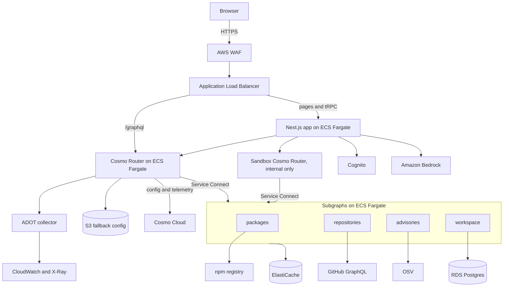

# Traverse specification

**Status:** Draft v2 · **Updated:** 2026-11-06

Traverse is built on [WunderGraph Cosmo](https://cosmo-docs.wundergraph.com/overview): Cosmo's composition engine powers its checks, the Cosmo Router serves its graph, and Cosmo Cloud is its schema registry, with Studio and `wgc` for checks and publishing. It's an independent project.

Traverse helps frontend developers explore a federated graph. It answers two questions: which subgraphs does my query touch, and what breaks if this schema changes? This document describes the target system. [Requirements](docs/REQUIREMENTS.md) define what must be true and how it's checked, and the [roadmap](docs/ROADMAP.md) shows what's built.

## Use cases

Every feature serves one of these jobs. A feature that doesn't is cut.

| Job                                      | Who                                 | How Traverse does it                                                                                                          |
| ---------------------------------------- | ----------------------------------- | ----------------------------------------------------------------------------------------------------------------------------- |
| Catch breaks in code that hasn't shipped | Frontend developer, schema reviewer | A CLI and GitHub Action read a repository's operations, compose the proposed schema, and report broken operations and screens |
| Find who owns a field                    | Frontend developer                  | Field to subgraph to owner lookup                                                                                             |
| See a query's cost before shipping       | Frontend developer                  | The real query plan as a route: subgraphs hit and fetch order                                                                 |
| Learn an unfamiliar graph                | New team member                     | A searchable graph map                                                                                                        |
| Vet a dependency                         | Any developer                       | Paste a `package.json` to see licences, advisories and maintenance from live data                                             |

Cosmo's [operations check](https://cosmo-docs.wundergraph.com/studio/schema-checks.md) uses router traffic, 7 days by default, so it can't see operations on a feature branch or ones that run rarely. Traverse reads the code, and complements `wgc subgraph check`. [GraphQL Inspector](https://github.com/graphql-hive/graphql-inspector) already validates operations against a schema. Traverse adds Cosmo's composition engine, subgraph and owner attribution, and screen mapping.

## Goals

- Show a frontend developer what a schema change breaks before it merges.
- Work on any Federation SDL, and be useful with no account.
- Serve real data through one hardened entry point.
- Deploy any subgraph or the router without failed requests.
- Keep serving when Cosmo Cloud is unreachable.
- Keep each user's saved work private by a verified identity.
- Trace any request from the load balancer to the database.
- Define all infrastructure in reviewed, tested code.

## Non-goals

- Replacing Cosmo Studio, Hub or `wgc subgraph check`.
- Multi-region failover.
- Self-hosting the Cosmo control plane.
- Payments and notifications.
- A native mobile app.

## Architecture



| Component                 | Responsibility                                                          |
| ------------------------- | ----------------------------------------------------------------------- |
| AWS WAF                   | Managed rule groups and a coarse rate rule at the edge                  |
| Application Load Balancer | TLS termination, target health, access logs                             |
| Next.js app               | The workbench UI, sessions, and tRPC from browser to server             |
| Cosmo Router              | JWT validation, persisted operations, limits, query planning, telemetry |
| Sandbox router            | Query plans and free-form read operations, for the web server only      |
| Subgraphs                 | Live public data, and users' saved work                                 |
| RDS Postgres              | Saved workspaces                                                        |
| ElastiCache               | Upstream response cache and rate-limit counters                         |
| S3                        | Fallback router configuration and persisted operations                  |
| Cosmo Cloud               | Schema registry, composition, config delivery, Studio analytics         |
| Amazon Bedrock            | Optional explanations and suggestions                                   |
| ADOT collector            | Sends traces and metrics to AWS                                         |

**Why two routers.** The workbench needs query plans and free-form operations, which GR-1 and GR-2 ban on the public router. A separate sandbox router, reachable only from the web server and limited to reads (GR-11), serves them, so the public router stays hardened.

### Environments

| Environment | Purpose                                    | Shape                                      |
| ----------- | ------------------------------------------ | ------------------------------------------ |
| Local       | Development and end-to-end tests           | Docker, with the pinned router image       |
| Staging     | Proving changes, load and resilience tests | Same stacks, smaller, single NAT gateway   |
| Production  | Live traffic                               | 3 Availability Zones, Multi-AZ data stores |

### Router sizing

Production starts with 3 tasks of 2 vCPU and 4 GB, and scales to 9 on CPU and requests per target. Tasks share their resources with the Service Connect proxy and the ADOT sidecar, so load tests confirm the final size.

### Shutdown timing

| Setting                  | Value | Reason                                                       |
| ------------------------ | ----- | ------------------------------------------------------------ |
| `SHUTDOWN_DELAY`         | 90s   | Total time for drain and shutdown                            |
| `DRAIN_PERIOD`           | 65s   | Longer than the load balancer idle timeout                   |
| `GRACE_PERIOD`           | 20s   | Time to finish in-flight requests                            |
| ALB deregistration delay | 90s   | Matches the router's shutdown                                |
| ALB idle timeout         | 50s   | Shorter than the router's fixed 60 seconds (C-38)            |
| ECS `stopTimeout`        | 120s  | The Fargate maximum, so the router is never killed mid-drain |

## Web app

A Next.js app in `apps/web`. Until M3 it's a static export with no server, hosted on GitHub Pages. From M3 it runs on a server.

| Route                   | Purpose                                                             |
| ----------------------- | ------------------------------------------------------------------- |
| `/`                     | Graph map                                                           |
| `/impact`               | Edit a schema draft and see composition errors, operations, screens |
| `/operations`           | Write an operation and see its route                                |
| `/packages/[name]`      | Package explorer, on live data                                      |
| `/sign-in`, `/sign-out` | Cognito sign-in and sign-out, needed only to save                   |

- Stack: Next.js, React, TypeScript, Tailwind, Radix, tRPC, Zustand, Monaco and React Flow.
- Composition runs in a Web Worker with `@wundergraph/composition`, so the page keeps responding (FR-WB-2).
- Pasted or uploaded SDL stays in the browser unless the user saves it.
- The server holds the session and calls the routers, so browser code never handles tokens (GR-9).
- Operations are written as `.graphql` documents, which generate typed clients (FR-WB-12) and the screen map.
- Every data view has loading, empty and error states.
- The design is dense and keyboard-first. Semantic tokens come from one source, using the Frox scale as the Tailwind theme, with rem sizing and AA contrast in light and dark themes.

### AI assistant

An optional layer over deterministic results, called only from the server through its task role. It explains results, suggests safe migrations and drafts operations. A suggestion is run through real composition, and a draft is validated against the schema, before either is shown (GR-12). See GR-12 to GR-15 and FR-AI-4.

## Interfaces

### CLI and GitHub Action

The CLI reads `traverse.json` at the root of a repository, and compares the working tree with a git ref:

```json
{
  "subgraphs": [
    { "name": "employees", "schema": "graph/employees.graphqls", "owner": "people-team" }
  ],
  "operations": ["src/**/*.graphql", "src/**/*.{ts,tsx}"],
  "screens": [{ "name": "Checkout", "operations": ["GetCart"] }]
}
```

`owner` and `screens` are optional. Each team fills them in, and Traverse never guesses an owner. Paths must stay inside the repository. A screen names operations, and an anonymous operation goes by its file path.

Operations come from `.graphql` and `.gql` files, and from `gql` tags, `graphql()` calls and `/* GraphQL */` comments in JavaScript and TypeScript source. Source is parsed and never run. Vue, Svelte and Astro files aren't read. Traverse drops `${...}` from a tag. A fragment still resolves, from any matched file. A tag left unreadable is listed under "Couldn't be checked" and only fails the check with `--strict`. A tag that still parses is checked as written, so a selection added by interpolation isn't seen, and a tag from an unrecognised package isn't found at all. Fragments that share a name must match, because either could otherwise replace the other and hide a break.

| Command                                                      | What it does                                                                                                                                                                                |
| ------------------------------------------------------------ | ------------------------------------------------------------------------------------------------------------------------------------------------------------------------------------------- |
| `traverse check --base <ref> [--markdown <file>] [--strict]` | Compares the two, using each side's own `traverse.json`, and can also write the report as Markdown. Operations come from both sides' patterns, so a pull request can't narrow its own check |
| `traverse comment --pr <number> --file <file>`               | Posts that file to a pull request, or updates the earlier comment. Reads `GITHUB_TOKEN` and `GITHUB_REPOSITORY`                                                                             |

| Exit code | Meaning                                                                                                                                                                                                                               |
| --------- | ------------------------------------------------------------------------------------------------------------------------------------------------------------------------------------------------------------------------------------- |
| 0         | No operation breaks. Operations that are affected but still valid are listed. Also a base with no `traverse.json`, which is skipped with a message                                                                                    |
| 1         | An operation breaks, or the proposed schema doesn't compose                                                                                                                                                                           |
| 2         | The check couldn't run: bad config or usage, the current schema doesn't compose, no operations matched, a screen names an unknown operation, fragments clash, git can't read the base, or with `--strict`, a file couldn't be checked |

The GitHub Action in `action.yml` runs both commands on `pull_request`. It comments only when something is affected, and updates that comment afterwards. Use `pull_request`, never `pull_request_target`, because the check reads files the pull request controls. On a fork's pull request the token is read-only, so the job summary and exit code report the result without a comment. To gate merges, pin the Action to a release and make the job a required check.

### Public API

- `POST /graphql` over HTTPS, for persisted operations only. The load balancer routes this path to the router for API clients; the web app reaches the router internally.
- Public data needs no token. A request may carry `Authorization: Bearer <JWT>`, and an invalid one is refused ([ADR 0015](docs/adr/0015-anonymous-public-reads.md)).
- `/health/ready` and `/health/live` serve the load balancer and the platform, and aren't public API.

### Identity

Tokens are issued by a Cognito user pool. A token's subject is the only source of user identity. The router validates each token, and the `workspace` subgraph verifies it again against the same keys, so it never trusts a caller's claim alone (GR-3). Public package data needs no sign-in.

### Graph

Each field that comes from a different upstream than its parent is nullable, so one failed source can't null a whole `Package` (FR-SG-6).

```graphql
# packages: npm registry and downloads API
type Package @key(fields: "name") {
  name: String!
  latestVersion: String!
  versions: [String!]
  license: String
  weeklyDownloads: Int
  repositoryUrl: String
  dependencies: [Dependency!]!
}

type Dependency {
  name: String!
  range: String!
}

type Query {
  package(name: String!): Package
}

# repositories: GitHub GraphQL
type Repository @key(fields: "url") {
  url: ID!
  stars: Int!
  latestRelease: String
  owner: String!
}

type Package @key(fields: "name") {
  name: String!
  repositoryUrl: String @external
  repository: Repository @requires(fields: "repositoryUrl")
}

# advisories: OSV
type Advisory @key(fields: "id") {
  id: ID!
  summary: String!
  severity: String
  fixedIn: String
}

type Package @key(fields: "name") {
  name: String!
  advisories(version: String): [Advisory!]
}

# workspace: Postgres
type Workspace @key(fields: "id") {
  id: ID!
  name: String!
  draftSchemas: [String!]!
  screenMap: String
}

type Query {
  workspaces: [Workspace!]!
}

type Mutation {
  saveWorkspace(name: String!, draftSchemas: [String!]!, screenMap: String): Workspace!
}
```

No operation accepts a user ID as an argument. This schema composes with `@wundergraph/composition` 0.66.2 (U-8). Field details may change in M2.

## Data model

| Subgraph       | Source                     | Rules                                                                       |
| -------------- | -------------------------- | --------------------------------------------------------------------------- |
| `packages`     | npm registry and downloads | No key. Maintainer emails are dropped on read (GR-16)                       |
| `repositories` | GitHub GraphQL             | Read-only token, server-side. 5,000 points an hour, so responses are cached |
| `advisories`   | OSV                        | No key                                                                      |
| `workspace`    | RDS Postgres, `workspace`  | Every row carries `user_id` and an index on it                              |

Upstream responses are cached in Redis, and each subgraph degrades clearly when its source is down (FR-SG-6). Tests replay recorded real responses, and a scheduled check compares them with the live sources (FR-SG-10).

## Delivery

Pull requests run every quality gate, `cdk diff` and `wgc subgraph check`. Merging to `main` deploys staging and runs smoke tests. Production waits for an approval.

Each release runs in this order, so the router never receives a schema ahead of the code:

1. Run database migrations.
2. Deploy subgraphs.
3. Publish schemas to Cosmo Cloud.

## Success criteria

- All requirements are `done`, with recorded verification.
- Developers use the CLI on their own repositories, and their findings are recorded.
- A rolling deploy under load produces no 5xx responses.
- With the Cosmo CDN blocked, running tasks and new tasks serve the last good configuration.
- Measured recovery meets the targets in [SLOs](docs/SLOS.md).
